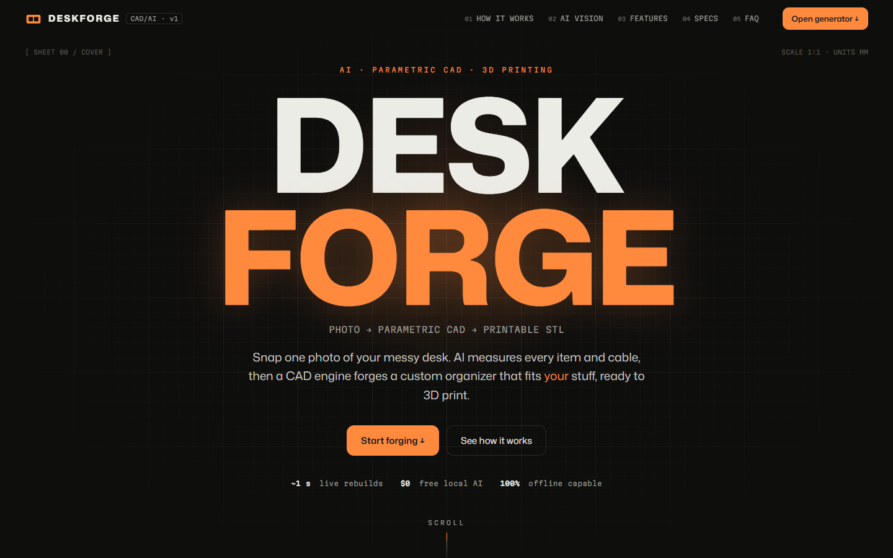
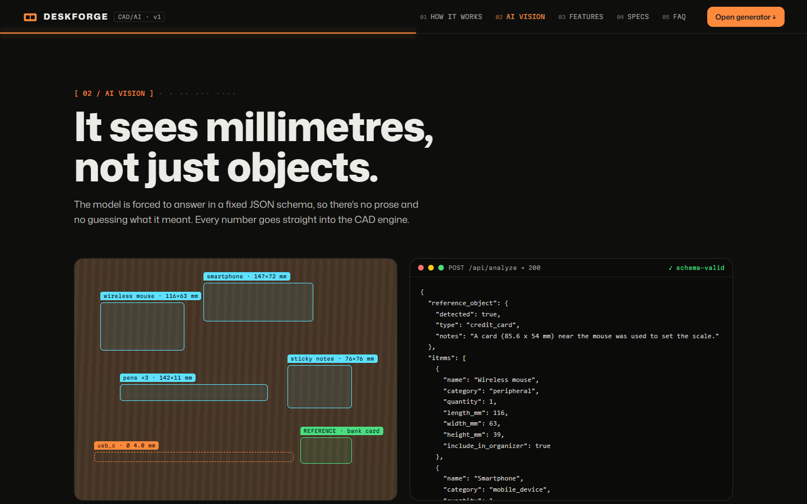
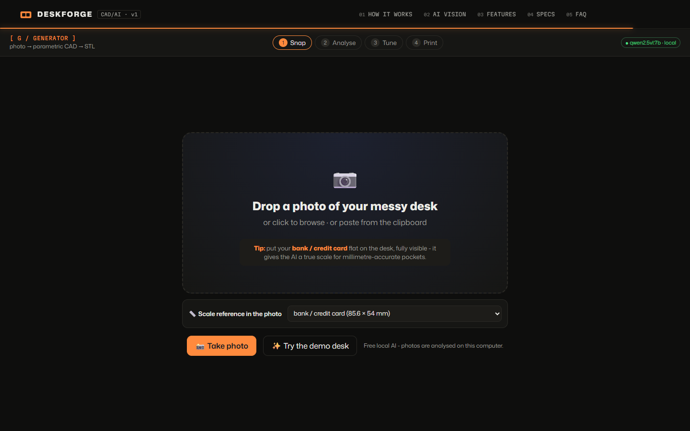
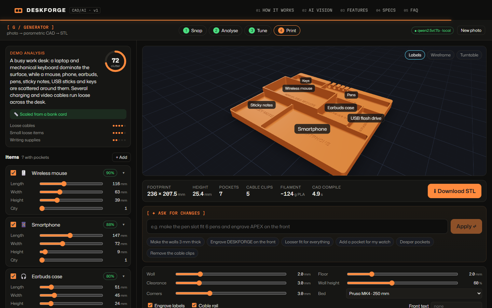
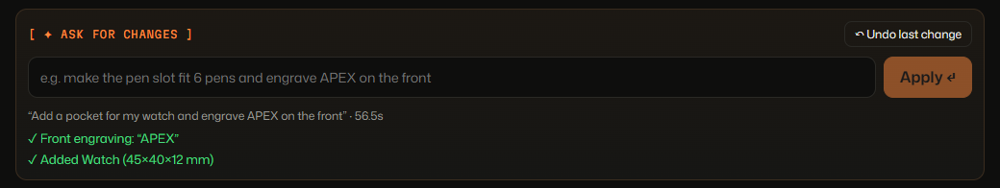
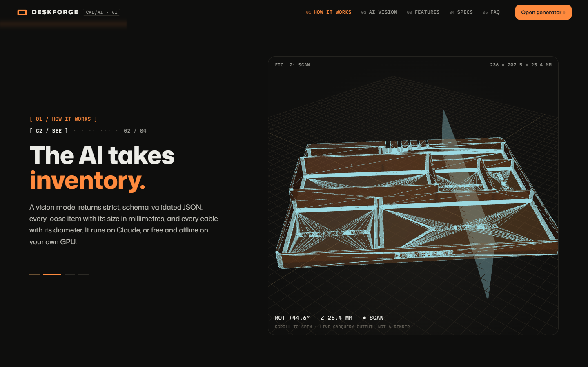
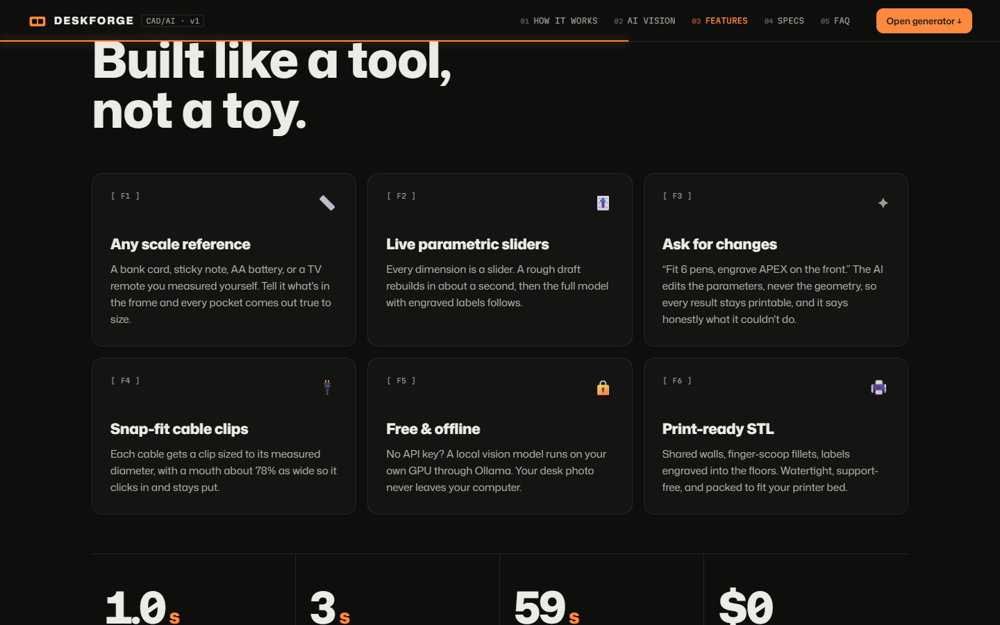

# DeskForge

**One photo of your messy desk → a custom, 3D-printable organizer that fits *your* stuff.**

AI measures every loose item and cable in millimetres, a parametric CAD engine forges a tray with a
pocket for each item and a snap-in clip for each cable, and you tune it live in 3D before downloading
the STL. Runs **free and fully offline** on a local AI, or on Claude.

[](https://anishpattanaik.github.io/deskforge/)
[](LICENSE)


**🌐 Website:** https://anishpattanaik.github.io/deskforge/ &nbsp;·&nbsp;
**🎬 Demo video:** _add your video link here_ &nbsp;·&nbsp;
**⬇ Sample STL:** [organizer.stl](frontend/public/demo/organizer.stl)



---

## How it works

| 1. Snap | 2. See | 3. Forge | 4. Print |
|---|---|---|---|
| Photograph your desk from above with a bank card, sticky note, or **any object you know the size of** for scale. Webcam, phone, or drag-and-drop. | A vision model returns **schema-validated JSON**: every item with L×W×H in mm, every cable with its diameter. | A layout packer fits pockets to your printer bed, and **CadQuery** cuts finger-scoop pockets, engraves labels and adds snap-fit cable clips. | Tune with sliders or plain English (“deeper pockets, engrave APEX”). It rebuilds live. Download a watertight, support-free STL. |



## The generator

| Upload or take a photo | Tune it live in 3D |
|---|---|
|  |  |

**Ask for changes in plain English.** The ✓ list is computed from the real before/after design, not from the AI's own summary:



| Scroll-driven 3D story on the website | Built like a tool |
|---|---|
|  |  |

## Features

- **Photo → measurements → CAD → STL**, end to end, in about a minute.
- **Any scale reference:** presets (bank card, sticky note, A4/Letter, coins, AA battery, ruler) or your own
  object and its size. The reference is automatically left out of the pockets.
- **Live parametric editing:** every dimension is a slider. A rough draft rebuilds in about 1 s, then the
  full model with engraved labels follows.
- **“Ask for changes”:** the AI edits *parameters only*, never raw geometry, so every result stays printable.
  Guards stop it touching items you didn't mention, it reports what's impossible (hinges, lids), and it has undo.
- **Snap-fit cable clips** sized to each cable's measured diameter, with a mouth about 78% as wide.
- **Free & offline:** Qwen2.5-VL runs locally through Ollama, so your photo never leaves your computer.
  Claude is used automatically if you add an API key.
- **Fits your printer:** the packer tries 3 orientations × 6 row widths and keeps the smallest layout that fits your bed.
- **Webcam capture** with a camera picker and a framing guide shaped like your reference object.

## Run it yourself

### Windows (one click)
1. Install [Python 3.11+](https://www.python.org/downloads/), [Node.js](https://nodejs.org/) and
   [Ollama](https://ollama.com/download) (Ollama is optional but gives you the free local AI).
2. ```bash
   ollama pull qwen2.5vl:7b
   ```
3. Download or clone this repo and double-click **`start.bat`**. The first run sets everything up, and
   the app opens at http://localhost:8000.

### macOS / Linux
```bash
git clone https://github.com/anishpattanaik/deskforge.git
cd deskforge
python3 -m venv .venv && source .venv/bin/activate
pip install -r backend/requirements.txt
(cd frontend && npm install && npm run build)
ollama pull qwen2.5vl:7b          # optional: free local AI
uvicorn app.main:app --app-dir backend --port 8000
```
Then open http://localhost:8000. (Developed and tested on Windows 11. The macOS/Linux commands are the same steps that `start.bat` runs.)

### Which AI analyses the photo?
The app picks automatically:

| Priority | Provider | Cost | Speed | Needs |
|---|---|---|---|---|
| 1 | Claude (`claude-opus-5-5`) | API credits | a few seconds | `ANTHROPIC_API_KEY` |
| 2 | Local Qwen2.5-VL 7B via Ollama | free, offline | ~1 min on a laptop iGPU (measured 59 s on an Intel Arc 140V; ~2 min on CPU) | Ollama + `ollama pull qwen2.5vl:7b` |
| 3 | Demo desk | free | instant | nothing |

- **Faster local AI on integrated graphics:** Ollama skips iGPUs by default. Run `setx OLLAMA_IGPU_ENABLE 1`
  once, then restart Ollama.
- **Add a Claude key later:** run `setx ANTHROPIC_API_KEY "sk-ant-..."`. `start.bat` also offers to save one on first launch.
- **Overrides:** `DESKFORGE_VISION=claude|local` forces a provider, and `DESKFORGE_LOCAL_MODEL` swaps the local model.

## Architecture

```
 photo ─► vision AI (Claude or local Qwen2.5-VL) ─► schema-validated JSON ─► editable cards + sliders
                                                                                  │  (debounced)
          STL ◄── CadQuery solid ◄── layout packer ◄── parameters ◄── plain-English edits (AI → params)
           │
           └──► Three.js viewer ──► Download STL ──► 3D printer
```

| Layer | File | What it does |
|---|---|---|
| API | `backend/app/main.py` | FastAPI routes, upload handling, demo fallback, STL serving |
| Vision (Claude) | `backend/app/vision.py` | Image validation/resizing, **structured outputs** (`messages.parse` + Pydantic schema), refusal handling, value clamping |
| Vision (local) | `backend/app/local_vision.py` | Ollama provider with the same schema enforced via grammar, plus output caps so busy photos always finish |
| Scale reference | `backend/app/reference.py` | Presets and custom objects, prompt hints, and removing the reference from the pockets |
| Prompt edits | `backend/app/edit.py` | Natural language → parameter operations, validated and clamped, diffed into an honest change list |
| Layout | `backend/app/layout.py` | Shelf packer: 3 orientations × 6 row widths, fits the bed, adds the cable rail |
| CAD | `backend/app/cad.py` | Shared-wall blocks, filleted finger-scoop pockets, engraved labels and front text, snap-fit clips, STL + filament estimate |
| Limits | `backend/app/limits.py` | Per-visitor AI limits and a concurrent-build cap for public hosting |
| Generator UI | `frontend/src/Generator.jsx` | Snap → Analyse → Tune → Print flow, live draft/full rebuilds, undo |
| 3D viewer | `frontend/src/components/Viewer.jsx` | react-three-fiber STL viewer: labels, pocket highlight on hover, wireframe, turntable |
| Website | `frontend/src/site/*` | Landing site: scroll-pinned 3D story, JSON terminal, feature cards, spec sheets, FAQ |

### Reliability
- **No guessing about the format:** the vision response must match the `DeskAnalysis` schema, and values are clamped into buildable ranges.
- **Small-model safety:** the local model's output is capped (≤ 12 items, short text fields) so it can't loop. A 24-object test finished in 95 s.
- **Honest AI edits:** the change list is computed from the real before/after parameters, and unrelated or impossible changes are blocked or reported.
- **Graceful failures:** uploads are checked (type, size, EXIF rotation), API and Ollama errors map to clear messages with hints, cosmetic CAD steps degrade instead of failing, and the UI has error boundaries around the 3D canvas.

## The website

https://anishpattanaik.github.io/deskforge/ is built in **static mode** (`VITE_STATIC=1`) and deployed by
`.github/workflows/pages.yml` on every push. GitHub Pages has no server, so it shows a real pre-built
organizer (`frontend/public/demo/`, regenerated with `python backend/export_static_demo.py`), while the
full generator runs on your PC. The `Dockerfile` self-hosts the full generator on any Docker host,
with per-visitor AI rate limits.

## Printing notes
- PLA, 0.2 mm layers, 2 walls, 15% infill. **No supports needed**, because every surface is vertical or faces up.
- If a cable clip is too tight, raise that cable's diameter slider by 0.3 mm.
- Pick your printer in the **Bed** dropdown (Ender 3, Prusa MK4, Bambu, 300 mm) and the layout repacks to fit.

## Tech stack
React 18 · Three.js / react-three-fiber · Vite · FastAPI · CadQuery (OpenCascade) · Pydantic ·
Claude (structured outputs) · Qwen2.5-VL via Ollama · GitHub Actions + Pages

## License
[MIT](LICENSE) © 2026 Anish Pattanaik
